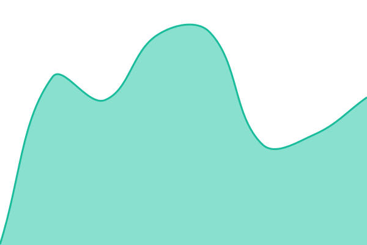

# McCoy Status

Live status page: **https://status.mccoy.org**

<!--start: status pages-->
<!-- This summary is generated by Upptime (https://github.com/upptime/upptime) -->
<!-- Do not edit this manually, your changes will be overwritten -->
<!-- prettier-ignore -->
| URL | Status | History | Response Time | Uptime |
| --- | ------ | ------- | ------------- | ------ |
|  [Learner app (Surface)](https://surface.mccoy.org/) | 🟩 Up | [learner-app.yml](https://github.com/McCoy-Universe/status/commits/HEAD/history/learner-app.yml) | <details><summary> 284ms</summary><br><a href="https://status.mccoy.org/history/learner-app"></a><br><a href="https://status.mccoy.org/history/learner-app"></a><br><a href="https://status.mccoy.org/history/learner-app"></a><br><a href="https://status.mccoy.org/history/learner-app"></a><br><a href="https://status.mccoy.org/history/learner-app"></a></details> | <details><summary><a href="https://status.mccoy.org/history/learner-app">100.00%</a></summary><a href="https://status.mccoy.org/history/learner-app"></a><br><a href="https://status.mccoy.org/history/learner-app"></a><br><a href="https://status.mccoy.org/history/learner-app"></a><br><a href="https://status.mccoy.org/history/learner-app"></a><br><a href="https://status.mccoy.org/history/learner-app"></a></details>
|  [Admin console (Terminal)](https://terminal.mccoy.org/) | 🟩 Up | [admin-console.yml](https://github.com/McCoy-Universe/status/commits/HEAD/history/admin-console.yml) | <details><summary> 258ms</summary><br><a href="https://status.mccoy.org/history/admin-console"></a><br><a href="https://status.mccoy.org/history/admin-console"></a><br><a href="https://status.mccoy.org/history/admin-console"></a><br><a href="https://status.mccoy.org/history/admin-console"></a><br><a href="https://status.mccoy.org/history/admin-console"></a></details> | <details><summary><a href="https://status.mccoy.org/history/admin-console">100.00%</a></summary><a href="https://status.mccoy.org/history/admin-console"></a><br><a href="https://status.mccoy.org/history/admin-console"></a><br><a href="https://status.mccoy.org/history/admin-console"></a><br><a href="https://status.mccoy.org/history/admin-console"></a><br><a href="https://status.mccoy.org/history/admin-console"></a></details>
|  [API](https://api.mccoy.org/) | 🟩 Up | [api.yml](https://github.com/McCoy-Universe/status/commits/HEAD/history/api.yml) | <details><summary> 223ms</summary><br><a href="https://status.mccoy.org/history/api"></a><br><a href="https://status.mccoy.org/history/api"></a><br><a href="https://status.mccoy.org/history/api"></a><br><a href="https://status.mccoy.org/history/api"></a><br><a href="https://status.mccoy.org/history/api"></a></details> | <details><summary><a href="https://status.mccoy.org/history/api">100.00%</a></summary><a href="https://status.mccoy.org/history/api"></a><br><a href="https://status.mccoy.org/history/api"></a><br><a href="https://status.mccoy.org/history/api"></a><br><a href="https://status.mccoy.org/history/api"></a><br><a href="https://status.mccoy.org/history/api"></a></details>
|  [Sign-in](https://surface.mccoy.org/__/auth/handler) | 🟩 Up | [sign-in.yml](https://github.com/McCoy-Universe/status/commits/HEAD/history/sign-in.yml) | <details><summary> 80ms</summary><br><a href="https://status.mccoy.org/history/sign-in"></a><br><a href="https://status.mccoy.org/history/sign-in"></a><br><a href="https://status.mccoy.org/history/sign-in"></a><br><a href="https://status.mccoy.org/history/sign-in"></a><br><a href="https://status.mccoy.org/history/sign-in"></a></details> | <details><summary><a href="https://status.mccoy.org/history/sign-in">100.00%</a></summary><a href="https://status.mccoy.org/history/sign-in"></a><br><a href="https://status.mccoy.org/history/sign-in"></a><br><a href="https://status.mccoy.org/history/sign-in"></a><br><a href="https://status.mccoy.org/history/sign-in"></a><br><a href="https://status.mccoy.org/history/sign-in"></a></details>

<!--end: status pages-->

## Posting an incident

Any unplanned outage lasting more than 60 minutes must be posted here, with updates until resolved.

- **Automatic:** when a check fails, an issue titled "🛑 <Component> is down" opens. Rename it to a customer-readable title, then post updates as comments (start each with **Investigating**, **Identified** or **Monitoring**). It closes itself when the check passes; add a final **Resolved** comment.
- **Manual** (checks green but users affected): open an issue, add the labels `status` and one of `learner-app`, `admin-console`, `api`, `sign-in`, post updates as comments, and close it after a **Resolved** comment.
- **Scheduled maintenance:** open an issue labelled `maintenance` whose body contains:

  ```
  <!--
  start: 2026-11-01T02:00:00Z
  end: 2026-11-01T03:00:00Z
  expectedDown: learner-app, api
  -->
  ```

Describe customer impact only — no internal service names, hosts, vendors or customer names.

Components are configured in [`.upptimerc.yml`](./.upptimerc.yml). Powered by [Upptime](https://upptime.js.org) (MIT).
